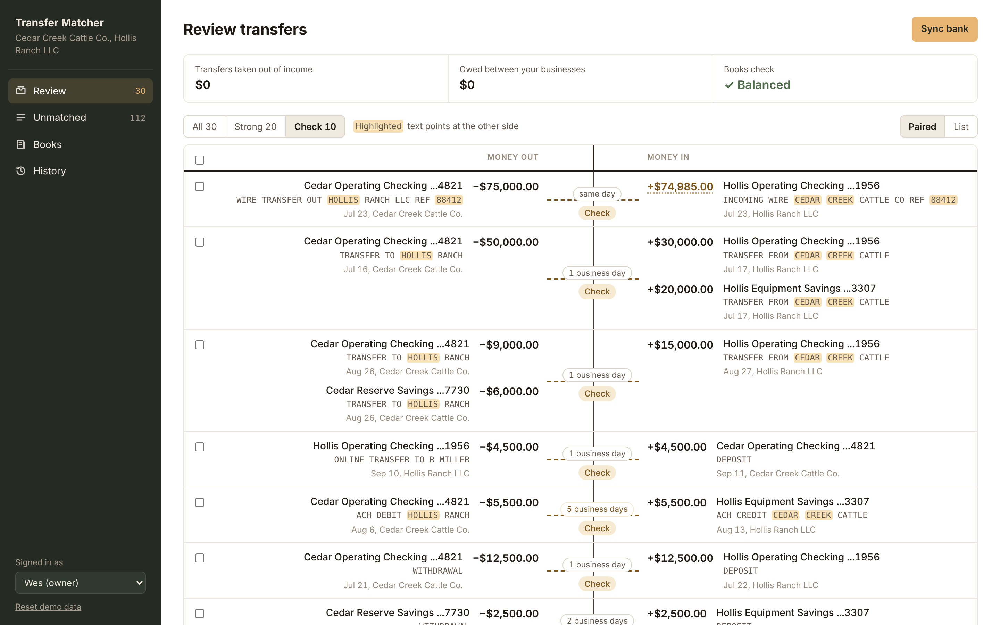
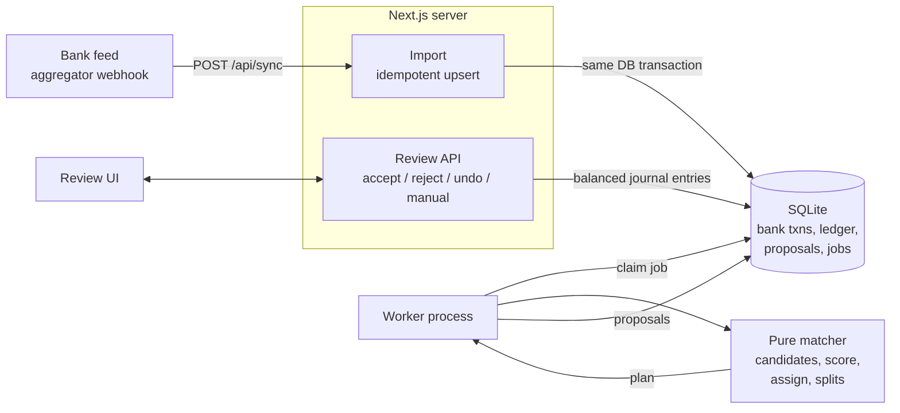
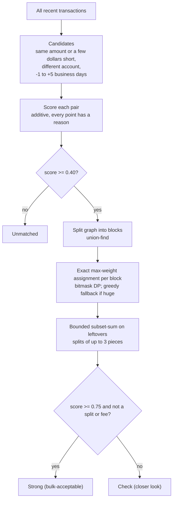
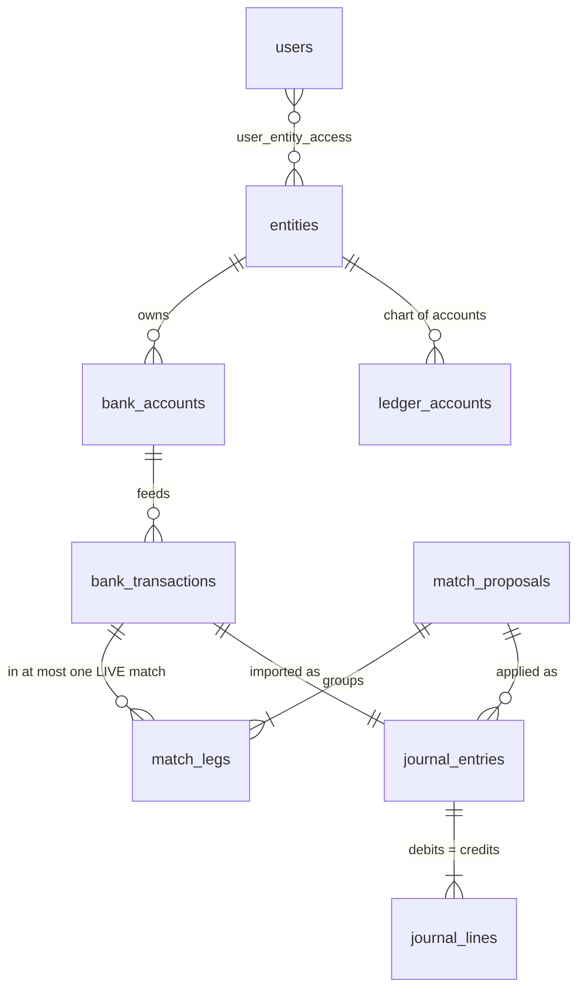

# Transfer Matcher

Finds the money a business owner moved between their **own** bank accounts and
legal entities, proposes matches for a human to review, and books the accepted
ones as balanced journal entries, so transfers stop showing up as income and
expenses.



## The problem

A rancher moves $40,000 from her operating account to her father's ranch, which
she also keeps the books for. The bank feed shows two unrelated lines:

```
Cedar Creek Cattle Co.  Operating Checking   Jul 14   -$40,000.00   TRANSFER TO HOLLIS RANCH
Hollis Ranch LLC        Operating Checking   Jul 15   +$40,000.00   TRANSFER FROM CEDAR CREEK CATTLE
```

A typical bank import books the withdrawal as an expense and the deposit as
income. Until someone pairs them by hand, Hollis Ranch looks $40,000 more
profitable than it is, Cedar Creek looks $40,000 less, and neither set of books
records that one business now owes the other. Those books feed tax returns and
the reports lenders use to set credit lines.

Pairing transfers sounds trivial (same amount, opposite sign) but real feeds
make it hard:

| What happens in real bank feeds | Example in the demo data |
|---|---|
| The two sides post days apart (ACH), or the deposit posts first | 0 to 5 business days apart; one deposit a day *before* its withdrawal |
| Memos are vague | `WITHDRAWAL` / `DEPOSIT` |
| Same-amount coincidences | a $5,000 feed bill on the same day as a $5,000 transfer |
| A fee is deducted in flight | $75,000 wire arrives as $74,985 |
| One transfer lands in several accounts | $50,000 out arrives as $30,000 + $20,000 |
| No transfer wording at all | a paper check written from one entity to the other |
| The other side never arrives (yet) | the deposit shows up in the *next* bank sync |

## Quick start

Requires Node 20+.

```bash
npm install
npm run seed       # creates data/app.db (SQLite, no server needed)
npm run dev        # http://localhost:3000
npm run worker     # in a second terminal: the background matcher
```

Click **Sync bank** to import the first batch of bank activity. If the worker
isn't running, the app notices and offers to run matching inline.

Other commands:

```bash
npm test           # 37 tests: matcher unit tests + service integration tests on real SQLite
npm run eval       # precision / recall against ground truth -> data/eval_report.md
npm run generate   # regenerate the synthetic bank feed (deterministic, seeded)
npm run seed -- --synced   # start with sync 1 already imported and matched
```

## The review screen

- **Paired view (default):** a T-chart. Money out on the left, money in on the
  right, amounts meeting at the center line so they can be compared without
  reading. Text in a memo that points at the other side (an account's last 4
  digits, the other business's name, a shared wire reference) is highlighted,
  so the evidence is visible, not just a score. A **List** view is one click away
  for scanning many rows.
- **Bulk actions:** checkboxes and select-all, then accept or reject. Each item
  is its own database transaction, so one stale item doesn't block the rest.
- **Detail drawer:** both bank lines, every reason behind the score, and what
  accepting does to the books in plain words. It pushes the page over instead
  of covering it, so both sides of the T stay visible.
- **Working through a queue:** accepting moves straight to the next match;
  `J`/`K` move, `A` accepts, `X` selects. Every accept offers **Undo**.

## How it works



1. **Import** (`lib/services/import.ts`). Upserts on `(account, provider_txn_id)`
   so re-sent data is a no-op, books each line the naive way, and enqueues a
   matching job **in the same database transaction**.
2. **Worker** (`scripts/worker.ts`, `lib/services/jobs.ts`). A separate process
   claims jobs atomically, retries with exponential backoff, and recovers jobs
   from crashed workers. Bursts of imports are debounced into one run.
3. **Matcher** (`lib/matcher/`). A pure function: transactions in, plan out. No
   database, no clock, no network.
4. **Review** (`lib/services/proposals.ts`). A person accepts, rejects, or undoes.
   Nothing touches the books without a human decision.
5. **Ledger** (`lib/services/ledger.ts`). Append-only double entry. Accepting
   posts reclassification entries; undo posts reversing entries. Nothing is
   ever updated or deleted.

### The matcher



**Scoring** (`lib/matcher/score.ts`): date closeness (45% weight), exact amount,
round amount, transfer wording, memo names the other account's last 4 digits,
memo names the other entity, shared reference number. Penalties: a memo that
looks like a real purchase or sale, or names a different account. Weights are
hand-set and explainable on purpose: there's no labelled data to train on yet,
and a reviewer (and an auditor) needs to see *why*.

**Why exact assignment, not greedy:** two identical $2,500 transfers two days
apart. Greedy grabs the closest-dated pair first and orphans the other two
transactions. Candidates only connect same-amount, close-date transactions, so
the graph splits into tiny blocks (usually 1x1) where an exact search is instant.

### The accounting

For each bank transaction in an accepted match, a reclassification entry moves
the amount out of whatever income or expense category the import guessed:

| Match type | Sender books | Receiver books |
|---|---|---|
| Same entity | Transfers in Transit (nets to 0) | Transfers in Transit |
| Between entities | Due from *receiver* (asset) | Due to *sender* (liability) |
| Fee taken in flight | | shortfall to Bank Fees |

Across entities, every Due-from has an equal Due-to, so they cancel on
consolidation. The app checks this live, along with "every entry balances".

### Data model



The invariant that matters most is enforced by the database, not app code:

```sql
CREATE UNIQUE INDEX one_live_match_per_transaction
  ON match_legs (transaction_id) WHERE active = 1;
```

If the background matcher and a person's manual match race for the same
transaction, the second write fails instead of double-booking money.

## Evaluation

On the synthetic feed (181 transactions, 32 real transfers, 6 traps):

| | |
|---|---|
| Recall (proposed in any tier) | 97% (31 / 32) |
| Precision, "Strong" tier (bulk-acceptable) | 100% (22 / 22) |
| Precision, "Check" tier | 90% (9 / 10) |
| Exact vs greedy assignment | 97% vs 91% recall |

Full report with window and threshold sweeps: [`data/eval_report.md`](data/eval_report.md).

**Read these numbers with care.** I wrote both the test scenarios and the
scoring weights, so this measures "does it handle the cases I thought of", not
real-world accuracy. It's a regression harness. In production the honest metric
is the reviewers' **rejection rate** on proposals, tracked over time.

Why precision over recall: a false positive hides real money (a $5,000 feed bill
called a "transfer" disappears from expenses). A false negative just leaves a
transfer for a person to match by hand, which is the status quo.

## Design decisions and tradeoffs

| Decision | Alternative | Why |
|---|---|---|
| Propose, review, then apply | Auto-apply above a threshold | Books feed taxes and loans. Trust is earned; bulk-accept keeps review fast. |
| Hand-weighted additive score | ML classifier | No labels yet; every point must be explainable. Reviewer decisions become the training set later. |
| Exact assignment per block | Greedy | Greedy mis-pairs identical same-week transfers (measured: -6pp recall). Blocks keep exact search cheap. |
| Splits always go to review | Treat like 1:1 | Subset-sum can find coincidental combinations. |
| Matching in a background worker | Inline in the import request | Webhook handlers must return fast; matching re-runs as late counterparts arrive. |
| DB-table job queue | Redis / Pub/Sub / Cloud Tasks | Enqueue is transactional with the import (no lost jobs, no outbox needed). Fine at this scale. |
| Optimistic locking (version column) | Row locks held while a person reviews | People take minutes to decide; holding locks that long doesn't work. |
| Append-only ledger | Update entries in place | Audit trail; undo is a reversing entry; accountants expect it. |
| Due-to / Due-from for intercompany | Equity contribution / distribution | The safe default. Which treatment is right is a judgment call for the owner or their accountant (future: let them choose). |
| SQLite | Postgres | Zero setup for a demo. Production: Postgres (row locks, `SKIP LOCKED` for workers). |

## What's built vs. designed

| Built here | Production design |
|---|---|
| SQLite file | Postgres (Cloud SQL) |
| Polling worker process | Cloud Run worker fed by Cloud Tasks / Pub/Sub |
| `x-user-id` header and a user switcher | Firebase Auth ID token verified server-side |
| Demo "sync" button | Bank-data aggregator webhooks, pending to posted reconciliation |
| Synthetic labelled feed | Reviewer accept/reject decisions as labels, rejection-rate dashboards |

## Limitations and what I'd do next

- **Paper checks between entities** are the remaining recall gap: no transfer
  wording at all. Fix: match check numbers against the check register, or read
  the check image.
- **Learn per-customer patterns.** "Auto transfer to SAV ...7730 every other
  Friday" should become a rule after a few accepts.
- **Learn from rejections.** Today a rejection only blocks that exact pairing.
  Repeated rejections of a pattern (say, payments to "R MILLER") should lower
  the score of similar pairs.
- **Many-to-many splits** aren't supported (rare, and ambiguous).
- **Holidays** are ignored in business-day math.
- **Multi-tenant**: every table would carry an `org_id`, and the job queue's
  dedupe key would be per org.

## Project layout

```
db/schema.sql               tables, indexes, invariants
lib/matcher/                the pure matching algorithm (+ tests)
lib/services/               import, jobs, matching runs, proposals, ledger, books (+ tests)
lib/org.ts                  the demo organization
app/                        Next.js UI and API routes
scripts/                    generate data, seed, worker, eval
data/                       synthetic bank feed, ground truth, eval report
```
